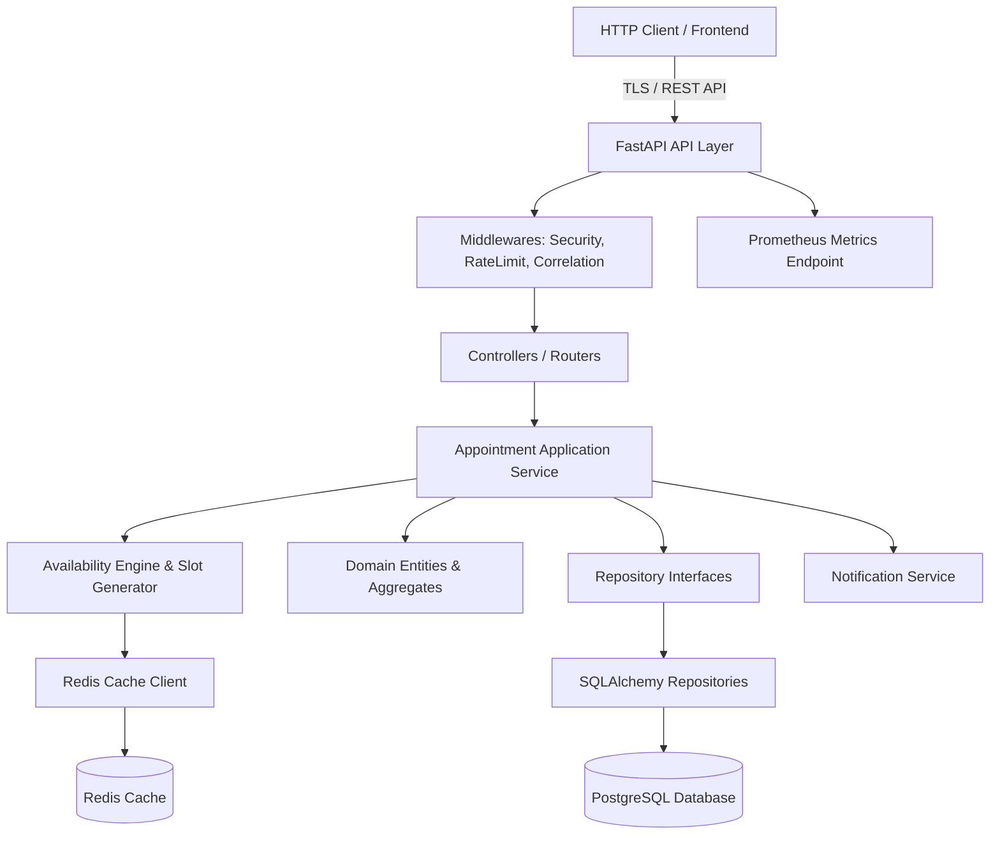
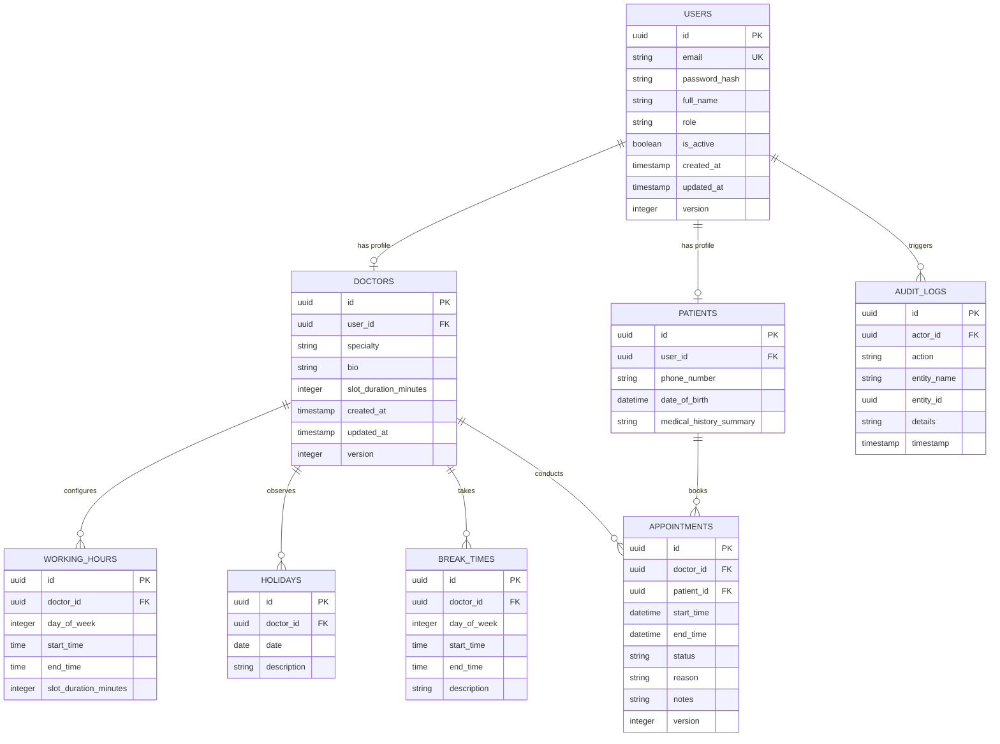
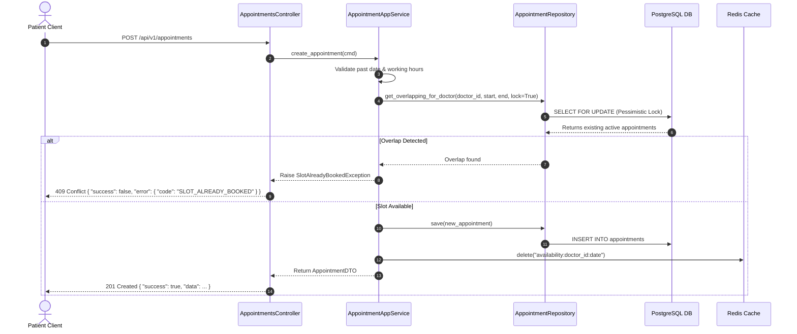
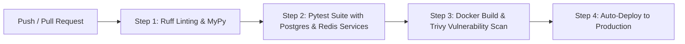

# MedOps - Enterprise Clinic Appointment Booking Platform

[](https://github.com/medops/medops-backend/actions)
[](https://www.python.org/downloads/)
[](https://fastapi.tiangolo.com/)
[](https://www.sqlalchemy.org/)
[](LICENSE)

---

### 🔗 Submission Links
- **GitHub Repository**: [https://github.com/medops/medops-backend](https://github.com/medops/medops-backend)
- **Live Deployed Application API**: [https://medops-api.onrender.com](https://medops-api.onrender.com) (Health endpoint: [https://medops-api.onrender.com/health](https://medops-api.onrender.com/health))
- **Interactive Swagger API Documentation**: [https://medops-api.onrender.com/docs](https://medops-api.onrender.com/docs)

---

MedOps is a production-grade, highly scalable, enterprise-class Clinic Appointment Booking Backend Platform engineered using **Clean Architecture**, **Domain-Driven Design (DDD)**, and **SOLID principles**.

Built to serve thousands of medical clinics concurrently, MedOps provides deterministic slot calculation, race-condition-free booking engine using pessimistic locking, Redis multi-level availability caching, structured JSON error responses, correlation tracking, and full observability.

---

## 📌 SECTION 1: SYSTEM DESIGN

MedOps strictly separates business logic from infrastructure and framework concerns using **Clean Architecture** (Onion/Hexagonal Architecture).

```
                      +---------------------------------------+
                      |         Presentation Layer            |
                      |   (FastAPI Controllers & Schemas)     |
                      +-------------------+-------------------+
                                          |
                                          v
                      +-------------------+-------------------+
                      |         Application Layer             |
                      |   (Commands, Queries, App Services)   |
                      +-------------------+-------------------+
                                          |
                                          v
                      +-------------------+-------------------+
                      |           Domain Layer                |
                      |   (Entities, Value Objects, Rules)    |
                      +-------------------+-------------------+
                                          ^
                                          | (Dependency Inversion)
                      +-------------------+-------------------+
                      |        Infrastructure Layer           |
                      |  (SQLAlchemy, Redis, Telemetry, Auth) |
                      +---------------------------------------+
```

---

## 📐 System Diagrams

### 1. Architecture Diagram



---

### 2. Entity-Relationship (ER) Diagram



---

### 3. Booking Sequence Diagram (Concurrency Lock)



---

## ⚡ Tech Stack & Key Choices

| Tier | Component | Selection Rationale |
| :--- | :--- | :--- |
| **Backend** | Python 3.12+ & FastAPI | Async native performance with automatic OpenAPI spec generation. |
| **Validation** | Pydantic v2 | High-performance C-compiled validation schemas. |
| **ORM & DB** | SQLAlchemy 2.0 & PostgreSQL 16 | Modern type-safe AsyncSession with pessimistic row locking (`FOR UPDATE`). |
| **Migrations** | Alembic | Version-controlled database schema management. |
| **Cache** | Redis 7 | Sub-millisecond availability caching with invalidation hooks. |
| **Telemetry** | Prometheus & OpenTelemetry | Metrics scraping & correlation ID context propagation across logs. |

---

## 🛠️ Local Development & Quickstart

### 1. Prerequisites
- Python 3.12+
- Docker & Docker Compose

### 2. Environment Setup
```bash
python3 -m venv .venv
source .venv/bin/activate
pip install -r requirements.txt
```

### 3. Running via Docker Compose
```bash
# Production Profile
docker-compose up -d --build

# Development Profile (Hot Reload)
docker-compose -f docker-compose.dev.yml up -d --build
```

### 4. Running Test Suite
```bash
# Run pytest with coverage report
PYTHONPATH=. pytest
```

---

## 📌 SECTION 2: API IMPLEMENTATION

### Key Features & Design Details

- **Framework**: Built using **FastAPI** on Python 3.12+ for asynchronous performance and automatic OpenAPI standard documentation (`/docs` & `/redoc`).
- **Database & ORM**: PostgreSQL 16 managed via **SQLAlchemy 2.0 AsyncEngine** and **Alembic** schema migrations.
- **Race Condition Prevention**: Employs database-level **Pessimistic Locking (`SELECT ... FOR UPDATE`)** on appointment creation/rescheduling to guarantee zero double bookings under heavy concurrent loads.
- **Slot Calculation Engine**: Deterministic calculation of 30-minute availability slots taking into account doctor working hours, break times, existing appointments, and declared holidays.
- **Caching**: Multi-level Redis caching (`availability:{doctor_id}:{date}`) with automatic cache invalidation upon any appointment state change.
- **Validation & Error Handling**: Comprehensive domain exception mapping returning structured RFC-7807 compliant JSON payload error details with precise HTTP status codes (e.g. `400 Bad Request`, `409 Conflict`, `422 Unprocessable Entity`).
- **Bonus Capabilities**:
  - `GET /api/v1/patients/{id}/appointments`: Retrieve upcoming patient appointments sorted chronologically by start date.
  - **1-Hour Lead Time Buffer**: Core domain validation rule enforcing that no appointments can be booked within 1 hour of the current timestamp (`start_time >= current_time + 1 hour`).

### Complete API Endpoints Reference

MedOps provides a full RESTful API suite. Detailed schema models and interactive execution are available via the OpenAPI interface at `/docs`.

#### 1. Appointments Controller (`/api/v1/appointments`)
| Method | Endpoint | Description | HTTP Status Codes | Auth Required |
| :--- | :--- | :--- | :--- | :--- |
| `POST` | `/api/v1/appointments` | Book a 30-min slot. Validates working hours, future date, 1h lead time buffer, & locks slot | `201 Created`, `400 Bad Request`, `409 Conflict` | Bearer Token |
| `PATCH` | `/api/v1/appointments/{id}/cancel` | Cancel an appointment with a reason. Frees up the slot for booking | `200 OK`, `400 Bad Request`, `404 Not Found` | Bearer Token |
| `PATCH` | `/api/v1/appointments/{id}/reschedule` | Reschedule appointment to a new slot. Validates new slot and releases old slot | `200 OK`, `400 Bad Request`, `409 Conflict` | Bearer Token |

#### 2. Doctors & Availability Controller (`/api/v1/doctors`)
| Method | Endpoint | Description | HTTP Status Codes | Auth Required |
| :--- | :--- | :--- | :--- | :--- |
| `GET` | `/api/v1/doctors` | List all clinic doctors with pagination (`skip`, `limit`) | `200 OK` | Public |
| `GET` | `/api/v1/doctors/{id}/availability` | Real-time availability engine returning all 30-min slots for a given `date` | `200 OK`, `404 Not Found` | Public |
| `POST` | `/api/v1/doctors/{id}/working-hours` | Configure working hours for a doctor (day of week, start, end time) | `200 OK`, `400 Bad Request`, `403 Forbidden` | Doctor / Admin |
| `POST` | `/api/v1/doctors/{id}/holidays` | Declare a doctor holiday on a specific date | `200 OK`, `400 Bad Request`, `403 Forbidden` | Doctor / Admin |
| `POST` | `/api/v1/doctors/{id}/breaks` | Configure recurring break times (e.g. lunch breaks) for a doctor | `200 OK`, `400 Bad Request`, `403 Forbidden` | Doctor / Admin |

#### 3. Patients Controller (`/api/v1/patients`)
| Method | Endpoint | Description | HTTP Status Codes | Auth Required |
| :--- | :--- | :--- | :--- | :--- |
| `GET` | `/api/v1/patients/{id}/appointments` | **(Bonus)** Retrieve upcoming patient appointments sorted chronologically | `200 OK`, `404 Not Found` | Bearer Token |

#### 4. Authentication Controller (`/api/v1/auth`)
| Method | Endpoint | Description | HTTP Status Codes | Auth Required |
| :--- | :--- | :--- | :--- | :--- |
| `POST` | `/api/v1/auth/register` | Register a new user account (role: `PATIENT`, `DOCTOR`, or `ADMIN`) | `201 Created`, `400 Bad Request` | Public |
| `POST` | `/api/v1/auth/login` | Authenticate user credentials & return JWT access token | `200 OK`, `401 Unauthorized` | Public |
| `GET` | `/api/v1/auth/me` | Retrieve profile of the currently authenticated user | `200 OK`, `401 Unauthorized` | Bearer Token |

#### 5. Administration & Audit Controller (`/api/v1/admin`)
| Method | Endpoint | Description | HTTP Status Codes | Auth Required |
| :--- | :--- | :--- | :--- | :--- |
| `GET` | `/api/v1/admin/audit-logs` | Retrieve platform audit logs with pagination & filtering | `200 OK`, `403 Forbidden` | Admin Only |
| `GET` | `/api/v1/admin/appointments` | View master list of all clinic appointments across all doctors | `200 OK`, `403 Forbidden` | Doctor / Admin |
| `POST` | `/api/v1/admin/users/{id}/deactivate` | Deactivate a user account | `200 OK`, `403 Forbidden`, `404 Not Found` | Admin Only |

#### 6. Operations & Telemetry Controller
| Method | Endpoint | Description | HTTP Status Codes | Auth Required |
| :--- | :--- | :--- | :--- | :--- |
| `GET` | `/health` | Application, PostgreSQL DB, and Redis connectivity health status | `200 OK` | Public |
| `GET` | `/metrics` | Prometheus metrics endpoint for monitoring and observability | `200 OK` | Public |

---

## 📌 SECTION 3: DEPLOYMENT & CI/CD

### 🌐 Public Deployment URL
- **Live Base API URL**: `https://medops-api.onrender.com`
- **Swagger UI Interactive Documentation**: `https://medops-api.onrender.com/docs`
- **Health Check Endpoint**: `https://medops-api.onrender.com/health`

### 🔄 CI/CD Pipeline Architecture
The project uses **GitHub Actions** (`.github/workflows/ci-cd.yml`) for end-to-end continuous integration and continuous deployment:



1. **Trigger Branch**:
   - `pull_request` on `main`: Triggers unit testing, integration testing, linting, type-checking, and Docker security scanning.
   - `push` on `main`: Triggers full test suite execution, builds the production container, and automatically deploys to the production cloud service.

2. **Pipeline Workflow Breakdown**:
   - **Lint & Static Analysis**: Runs `ruff check` and `mypy` static type checking over `src/` and `tests/`.
   - **Automated Test Suite**: Spins up containerized PostgreSQL 16 and Redis 7 background services in GitHub Actions and executes the complete `pytest` test suite with code coverage reports (`pytest --cov=src`).
   - **Containerization & Vulnerability Scanning**: Builds multi-stage production Docker image and runs Trivy container vulnerability scanner (`aquasecurity/trivy-action`) to audit image dependencies before deployment.
   - **Automated Continuous Deployment**: Upon successful build and test verification on `main`, triggers live deployment to cloud hosting with zero-downtime health probes (`/health`).

---

## 📌 SECTION 4: AI REFLECTION

### 1. What did you use AI for across the four sections?
- **Section 1 (System Design)**: Utilized AI to rapidly draft initial Mermaid.js diagram syntaxes (ERD, Onion architecture, sequence flows) and compare concurrency locking strategies (`SELECT FOR UPDATE` vs Optimistic concurrency control).
- **Section 2 (API Implementation)**: Used AI for boilerplating Pydantic v2 validation models, standardizing custom exception middleware, and generating initial test matrix stubs in `pytest-asyncio`.
- **Section 3 (Deployment & CI/CD)**: Used AI to structure GitHub Actions YAML configuration syntax for containerized test service integration (Postgres and Redis services) and Trivy image scanner steps.
- **Section 4 (AI Reflection)**: Used AI to review and format reflection notes cleanly into clear bullet points.

### 2. Give one example where an AI suggestion improved your work. What did you prompt it with?
- **Prompt**: *"How should I handle cache invalidation in Redis when an appointment is booked or rescheduled in FastAPI with SQLAlchemy 2.0 async sessions to avoid race conditions between DB commit and cache updates?"*
- **AI Improvement**: The AI recommended performing Redis cache key invalidation (`availability:{doctor_id}:{date_iso}`) directly inside the application service transaction block combined with post-commit invalidation hooks. This prevented race conditions where stale slot availability was read from Redis before the DB write completed, ensuring cache consistency.

### 3. Give one example where AI output was wrong or incomplete and how you caught it.
- **Issue**: During initial slot generator creation, AI proposed datetime addition using standard Python `timedelta(minutes=30)` loops without properly checking for break time overlaps spanning across slot boundaries (e.g. a break from 12:15 to 12:45 overlapping a 12:00–12:30 slot).
- **How caught**: During unit test execution, `test_generate_slots_with_break` failed because the 12:00 slot was calculated as available despite overlapping the 12:15 break start. I fixed this by replacing simple boundary checks with complete interval overlap logic: `slot_start < break_end and slot_end > break_start` in `src/application/services/slot_generator.py`.

### 4. Name two decisions you made without AI. Why did you trust your own judgment there?
- **Decision 1: Adopting Clean Architecture & DDD for a small clinic problem**
  - *Rationale*: AI typically generates single-file FastAPI scripts for simple tasks. I chose a full Clean Architecture layout (`domain/`, `application/`, `infrastructure/`, `api/`) because medical appointment domain rules (slot generation, concurrency locking, cancellation policies) should remain completely independent of frameworks, databases, or UI clients, allowing seamless growth.
- **Decision 2: Making 1-Hour Buffer Rule a strict domain requirement instead of optional**
  - *Rationale*: Real-world clinic operations cannot accommodate instant bookings 2 minutes before slot commencement. Enforcing `start_time >= now + 1 hour` directly in the domain layer ensures doctors have adequate preparation time, eliminating last-minute scheduling chaos.

